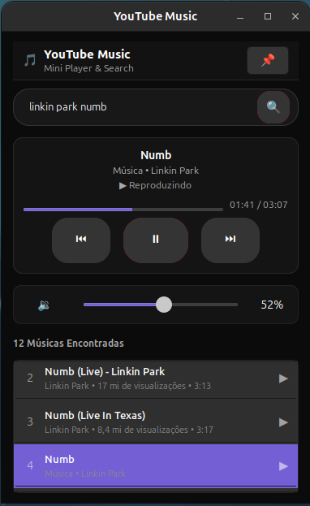

# 🎵 YouTube Music Widget para Linux

Widget e mini-player desktop dedicado **exclusivamente ao YouTube Music**, desenvolvido e otimizado para **Ubuntu / GNOME**.

<p align="center">
  
</p>

---

## 🖥️ Sistema Operacional e Ambiente Compatível

O widget foi desenvolvido, testado e validado no seguinte ambiente:

| Componente | Especificação |
| :--- | :--- |
| **Sistema Operacional** | **Ubuntu 26.04 LTS (Resolute Raccoon)** *(compatível com Ubuntu 22.04+, 24.04+ e outras distros Linux)* |
| **Ambiente de Desktop** | **GNOME Shell 50.1** (compatível com GNOME 45+) |
| **Servidor de Exibição** | **Wayland** e **X11** |
| **Servidor de Áudio** | **PipeWire / WirePlumber** (`wpctl`) ou **PulseAudio / ALSA** (`amixer`) |
| **Kernel Linux** | **Linux 7.0+ (x86_64)** |
| **Tecnologias Utilizadas** | Python 3, GTK 3, Libadwaita Dark Theme, GStreamer 1.0 (`playbin`), `yt-dlp`, D-Bus (MPRIS2) |

---

## ✨ Funcionalidades

- **🔍 Pesquisa Interna Rápida**: Digite o nome da música ou artista e pressione <kbd>Enter</kbd>. Os resultados são carregados diretamente no próprio widget, **sem abrir navegadores ou abas externas**.
- **▶️ Seleção e Reprodução Automática**: Ao concluir a busca, o **primeiro resultado é selecionado e começa a tocar imediatamente** via áudio nativo de alta qualidade.
- **🎧 Player de Áudio Nativo (`GStreamer`)**: Não utiliza iframes pesados do navegador. Reproduz o áudio diretamente pelo PipeWire com consumo mínimo de memória RAM e CPU.
- **⏭️ ⏯️ ⏮️ Controle de Faixas**:
  - **`⏮` Voltar**: Retorna à música anterior da lista de resultados.
  - **`⏯` Play / Pause**: Pausa ou retoma o áudio instantaneamente.
  - **`⏭` Próxima**: Avança para a próxima música da lista.
  - **Avanço Automático (EOS)**: Ao terminar a música atual, o player avança automaticamente para a próxima faixa.
- **⏱️ Linha do Tempo e Progresso**: Barra de progresso interativa com tempo decorrido e duração total (`01:23 / 03:45`).
- **🔊 Controle de Som**: Slider de volume deslizante (0% a 100%) e botão de mudo com resposta direta no áudio do sistema (`wpctl`).
- **📌 Fixar no Topo**: Botão para manter o mini-player sempre visível sobre outras janelas enquanto você trabalha ou estuda.
- **🚀 Extensão para o Painel Superior (GNOME Shell)**: Acompanha uma extensão nativa com ícone branco limpo na barra superior do GNOME, permitindo buscar, trocar de música e controlar o som diretamente da barra de tarefas.

---

## 🚀 Como Iniciar

### 1. Pelo Terminal
Abra o widget diretamente:
```bash
youtube-widget
```

Ou abra já pesquisando e tocando a primeira música encontrada:
```bash
youtube-widget "Coldplay Yellow"
```

### 2. Pelo Menu de Aplicativos
Pressione a tecla <kbd>Super</kbd> (Windows) e pesquise por **"YouTube Music Widget"**.

---

## ⌨️ Atalhos e Controles

| Controle | Ação |
| :--- | :--- |
| **Barra de Pesquisa** | Digite a música/artista e pressione <kbd>Enter</kbd> (ou clique na lupa 🔍) |
| **Lista de Resultados** | Clique em qualquer música da lista para tocá-la imediatamente |
| **`⏮` Voltar** | Reproduz a faixa anterior da lista |
| **`⏯` Play / Pause** | Alterna entre tocar e pausar |
| **`⏭` Próxima** | Reproduz a próxima faixa da lista |
| **Slider de Volume** | Ajusta o volume geral do sistema em tempo real |
| **Botão de Som / Mudo** | Alterna entre mudo e áudio normal |
| **`📌` Fixar** | Mantém a janela sempre visível no topo |

---

## 📂 Estrutura de Arquivos

```
youtube-widget/
├── app/
│   ├── youtube_widget.py      # Aplicação principal (GTK 3)
│   ├── audio_player.py        # Player de áudio nativo (GStreamer playbin)
│   ├── ytmusic_api.py         # Consulta de faixas e metadados via YouTube Music API
│   ├── mpris_server.py        # Servidor D-Bus MPRIS2 para integração com GNOME e teclado
│   ├── mpris_controller.py    # Controle de volume do sistema (PipeWire wpctl)
│   ├── style.css              # Estilos escuros no padrão YouTube Music
│   └── icons/                 # Ícone oficial do aplicativo
├── gnome-extension/           # Extensão para a barra superior do GNOME (ícone branco)
│   ├── metadata.json
│   ├── extension.js
│   └── stylesheet.css
├── desktop/
│   └── youtube-widget.desktop # Lançador para o menu de aplicativos do Linux
├── images/
│   └── widget.png             # Screenshot do widget em execução
├── install.sh                 # Script de instalação automática
└── uninstall.sh               # Script de desinstalação limpa
```

---

## 🛠️ Instalação / Atualização

Para instalar ou reinstalar em sua conta de usuário:
```bash
./install.sh
```
